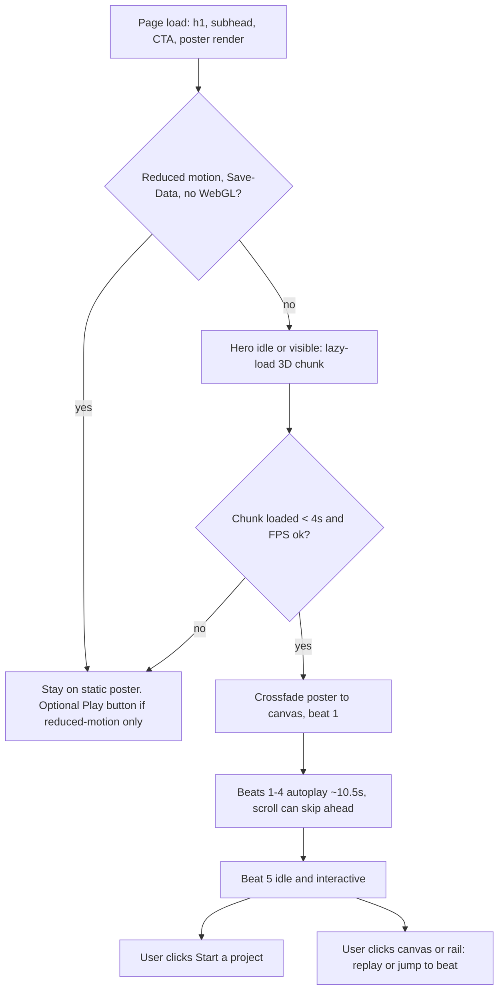

# VLC-19 — Home hero: 3D "code → software" story (UI & motion spec)

Status: for CTO sign-off · Scope: home Hero only · Implementation: VLC-20 (parent VLC-18)

## 0. Findings that shape this spec

1. **The current theme is pure monochrome.** Tokens actually in the repo: `bg-black`, `text-white`, borders `white/10` (header) and `white/15` (cards), muted text via `opacity-80`, `bg-black/70 + backdrop-blur` (header), Geist Sans + Geist Mono, `rounded-2xl`, `max-w-6xl px-6`, `themeColor #000000`. There is **no blue/accent token**. The brief says "glass/blue cubes" _and_ "palette strictly from existing tokens"; both cannot be true.
   **Default in this spec: monochrome glass** (white-alpha fills, white edges, white glow on black). This keeps the theme unchanged. See Open decision D1 for the optional single accent.
2. The home page is currently `PageStub` plus a reveal demo. The Hero is a new component replacing the stub on `/`. Header is `sticky h-16` (64px) and stays.
3. Motion stack in repo: GSAP + ScrollTrigger + Lenis, reduced-motion handled via `gsap.matchMedia()`. This spec reuses it as the master timeline; WebGL is only the renderer.
4. I worked from the task description; I did not have the two reference images (Radom glass cube on chip, Harness glowing pipes) open. The visual language below (glass cube on a chip-like base, glowing pipes) follows their description.

## 1. User and goal

- **User:** a business owner / founder landing on v3lcode.com who wants software, a site or an app built and hosted.
- **Goal:** understand in under 10 seconds that V3L turns code into a finished, hosted product, then click **Start a project**.
- **Success:** hero story is understood without reading; CTA visible without scrolling at every breakpoint; LCP and CLS unaffected by the 3D layer; page works with the animation entirely absent.

## 2. Flow



## 3. Storyboard

Master timeline T = 10.5 s, built once in GSAP (`gsap.timeline({paused:true})`); the canvas reads `timeline.progress()` each frame. The same timeline serves autoplay, scroll-skip and rail jumps.

| # | Beat | Time | Trigger | What happens | Easing |
|---|------|------|---------|--------------|--------|
| 1 | **Write** | 0.0–3.0 s | Autoplay when canvas is ready and hero ≥50% visible | A code editor panel (glass panel, `rounded-2xl`, `border white/15`) types a 7-line snippet at ~45 chars/s with ±25% jitter. Blinking caret 1 Hz (steady, not blinking, under reduced motion). | `none` (linear, jittered) |
| 2 | **Build** | 3.0–5.0 s | Autoplay (follows 1) | Each token/line detaches from the text, shrinks and morphs into a small glass cube (≈24 cubes). Editor panel fades to 0 over 0.6 s. Cubes hover in a loose cloud, brief shimmer sweep on their edges. | `power3.out`, stagger 0.04 s |
| 3 | **Flow** | 5.0–7.5 s | Autoplay; **scroll-skippable** | Cubes align and travel single-file along 3 glowing pipes (white core, soft halo) across a chip-like base plate. Light pulses run along the pipes (dash offset). | cubes `sine.inOut`; pulses `none` |
| 4 | **Ship** | 7.5–10.0 s | Autoplay; **scroll-skippable** | Cubes arrive at the end of the pipes and unfold into a product UI: sidebar, top bar, 3 stat cards, bar chart. Panels are glass, edges draw in, then a one-time light sweep. | `expo.out`, slight `back.out(1.2)` on panel scale |
| 5 | **Live** (idle) | 10.0 s → ∞ | Autoplay completes → interactive | Product UI floats (±4 px, 6 s sine yoyo). Pipes keep a slow ambient pulse (1 per 3 s). Pointer tilt, hover highlight and click are enabled. Render loop drops to 30 fps when no pointer movement for 5 s. | `sine.inOut` yoyo |

Caption row under the canvas (Geist Mono, `text-xs`, `opacity-80`, one visible at a time): `01 Write` · `02 Build` · `03 Flow` · `04 Ship` · `Live`. Changes with a 200 ms crossfade.

**Beat 1 code snippet (exact, typed as real characters):**

```ts
const app = await v3l.build({
  idea: "your product",
  stack: ["web", "mobile"],
  host: "managed",
});
app.ship();
```

Syntax distinction uses **opacity, not hue**: keywords `white/100`, strings `white/80`, punctuation `white/55` (≥ 4.5:1 on black).

**Scroll behaviour (desktop ≥1024 px only).** Hero is pinned (`ScrollTrigger pin`) for 150 vh of scroll. Effective playhead `t = max(autoplayTime, scrollProgress × T)`. Scrolling during beats 1–4 skips ahead (never rewinds the autoplay). Once beat 5 is reached the pin releases and the canvas parallaxes out (`y: -8%`, scale 0.96, opacity 1→0.4 over the next 60 vh). Scrolling back to the top resets nothing; the scene stays in beat 5. Mobile/tablet: no pin, no scroll coupling.

## 4. Layout and canvas placement

The canvas is **beside** the headline on desktop and **below the CTA** on smaller screens. It never sits behind the text (keeps contrast trivially AA and keeps the 3D layer out of the LCP element).

All breakpoints use the existing container: `mx-auto max-w-6xl px-6`.

**Desktop ≥1024 px** (min-height `calc(100svh - 4rem)`)

```
┌───────────────────────────────────────────────────────────┐
│ header 64px                                               │
├───────────────────────────────────────────────────────────┤
│  [5 cols]                       [7 cols, bleeds to right  │
│  h1  Code in.                    edge of viewport]        │
│      Software out.               ┌──────────────────────┐ │
│  subhead (2-3 lines)             │   CANVAS  aspect 4:3 │ │
│  [ Start a project ]  See        │   (editor → cubes →  │ │
│  services →                      │    pipes → product)  │ │
│                                  └──────────────────────┘ │
│                                   01 Write · 02 Build …   │
└───────────────────────────────────────────────────────────┘
```

**Tablet 768–1023 px**: single column. Order: h1, subhead, CTA row, canvas (aspect 16:10, full container width), caption row. No pin.

**Mobile <768 px**: single column. Order: h1, subhead, CTA (full width, 48 px tall), canvas (aspect 4:5, max-height 60 svh, full container width), caption row. CTA fully visible on a 360×640 viewport without scrolling.

Reserve canvas space with `aspect-ratio` so CLS = 0 (poster and canvas occupy the same box).

**Type (existing Tailwind scale, bold + tight tracking as the logo):** h1 `text-4xl sm:text-5xl lg:text-6xl font-bold tracking-tight`; subhead `text-base sm:text-lg opacity-80`, max 36 ch per line on desktop.

## 5. Interactions (desktop fine pointer unless stated)

| Interaction | Behaviour |
|---|---|
| Parallax tilt | Scene group rotates toward pointer: max ±6° yaw, ±4° pitch; pointer tracked over the whole hero; lerp 0.08/frame; returns to 0 on pointer leave (600 ms `power2.out`). Active in beat 5 and at 30% strength during 3–4. Off for touch. |
| Hover highlight | Raycast on product panels / cubes (throttled to 30 Hz). Hovered item: edge `white/100`, scale 1.04, glow ×1.5, 150 ms `power2.out`. Panels show a label: **Web**, **Apps**, **Hosting**, **Domains** (decorative; the real service links live in the page below). Cursor stays default (nothing is a link). |
| Scroll skip | See §3. |
| Click / tap canvas | During 1–4: skip to beat 5. In beat 5: replay from beat 1 (600 ms fade-through). |
| Beat rail | 5 ticks under the canvas, each a real `<button>` (44×44 px hit area, visible tick 8 px). Click jumps to that beat (0.8 s scrub). Current beat has `aria-current="step"`. Keyboard: Tab/Enter/Space. |
| Visibility | Render loop pauses when canvas is <10% visible or tab hidden; resumes at the same playhead. |

## 6. States

| State | Behaviour |
|---|---|
| Initial / loading | Headline, CTA and **poster** render immediately (server HTML). 3D chunk requested after `requestIdleCallback` (fallback `setTimeout 1200`) and only if hero ≥50% visible. No spinner. |
| Ready | Poster → canvas crossfade 300 ms, then beat 1 starts. |
| Slow / failed load | If the chunk is not ready in 4 s, or WebGL init throws, or `webglcontextlost` fires: stay on / return to poster, silently. No error UI. |
| Low FPS | Sample 60 frames after start: median <45 fps → drop to Lite; Lite <45 fps → poster. |
| No JS | Server HTML shows poster + all copy. |
| Reduced motion | Poster only. No autoplay, tilt, pin, shimmer, caret blink. A text button **Play animation** under the poster (user-initiated) plays beats 1–5 once with cross-fades instead of travel (no pin, no tilt, no flashing). |
| Save-Data / `(pointer: coarse)` + low memory | Poster only (see tiers). |
| No permission / empty / error data | N/A (no user data on the hero). |
| Long / odd content | Headline wraps to 3 lines at 320 px without clipping; CTA labels never truncate (`min-h-12`, `px-6`). |

**Quality tiers**

| Tier | Who | Settings |
|---|---|---|
| A Full | desktop, fine pointer, WebGL2 | DPR ≤1.75, 24 cubes, tilt + hover |
| B Lite | tablet / touch phones with `deviceMemory ≥ 4`, not Save-Data | DPR ≤1.5, 12 cubes, no tilt/hover, tap to replay |
| C Poster | everything else, plus all failure paths | static image |

## 7. Copy (exact)

| Element | Text |
|---|---|
| h1 | `Code in. Software out.` |
| Subhead | `V3L Code turns your idea into software, websites and apps, then hosts and runs them for you.` |
| Primary CTA (→ `/contact`) | `Start a project` |
| Secondary text link (→ `/services`) | `See our services` |
| Captions | `01 Write` · `02 Build` · `03 Flow` · `04 Ship` · `Live` |
| Panel hover labels | `Web` · `Apps` · `Hosting` · `Domains` |
| Reduced-motion button | `Play animation` |
| Canvas wrapper | `role="img"`, `aria-label="Animation: code being typed turns into glass cubes that flow through a pipeline and assemble into a finished app."` |
| Poster `alt` | Same as aria-label, but "Illustration:" instead of "Animation:". |

SEO note: the h1 changes from the brand name to a tagline. Brand and keywords remain in `<title>`/description. SEO & Marketing should confirm via CTO before build (D2).

## 8. Palette and visual tokens (existing theme only)

| Use | Token |
|---|---|
| Page / canvas background | `black` (canvas is transparent over `bg-black`; no gradient fills) |
| Cube / panel fill | white, 6–12% alpha |
| Edges / pipe core | white, 40% idle, 100% on hover or pulse |
| Glow / halo | white additive, ≤25% alpha |
| Editor and card border | `white/15` (same as existing cards) |
| Text | `white`, secondary `opacity-80` |
| Radius | `rounded-2xl` for editor panel and canvas frame; cube edge bevel is visual only |
| Fonts | Geist Mono for code and captions, Geist Sans for the rest |
| Depth | Distance fog fades to black; no drop shadows |

No new hex values. Contrast: white on black 21:1; lowest code text (`white/55`) ≈ 5.8:1; caption `opacity-80` ≈ 12:1.

## 9. Components

Reuse: container (`max-w-6xl px-6`), button/link styling (the header's `opacity-80 hover:opacity-100`; primary CTA = white fill, black text, `rounded-full`, `min-h-12` — new variant, no primary button exists yet), `MotionProvider` (GSAP/Lenis), `useGSAP` + `gsap.matchMedia()` conventions.

New:
- `Hero` (server component: copy, CTA, poster, reserved aspect box).
- `HeroScene` (client, `next/dynamic` with `ssr:false`; canvas, timeline, interactions).
- `BeatRail` (5 buttons + caption).
- `HeroPoster` (static image, same box).
  Justification: no hero or canvas component exists; the split keeps the 3D chunk off the critical path.

Engineering hints (CTO's call): vanilla `three` with named imports and InstancedMesh beats react-three-fiber on bundle size. Fake the glass (fresnel `ShaderMaterial` + `LineSegments` edges + additive sprites); avoid `MeshPhysicalMaterial` transmission, post-processing packages, HDRI and glTF files. Typed code is DOM text over the canvas in beat 1 (real text, crisp, accessible to the layout), not a texture.

## 10. Performance budget

- **≤300 KB gz extra JS** for the whole hero 3D chunk, **0 KB added to the initial/critical bundle** (verify in `next build` output and with a size check in CI).
- Chunk loads lazily (idle + visible); no impact on LCP element (h1) and CLS = 0.
- **60 fps** on a mid laptop (integrated GPU, 1440×900, DPR 1.75): ≤150 draw calls, ≤60k triangles, ≤2 MB GPU textures, no per-frame allocations.
- Poster ≤60 KB (AVIF/WebP, `priority` not needed; it is not the LCP element), served at 1× and 2×.
- Cap rendering to 30 fps when idle in beat 5; fully pause offscreen / hidden.
- Dispose geometries, materials, listeners and the GSAP timeline on unmount (`useGSAP` scope).

## 11. Responsive and React Native

Web only for this hero. If a React Native app later reuses the story, use the poster or a Lottie export of beat 5; do not port three.js. Touch: no hover or tilt; tap replaces them.

## 12. Accessibility (WCAG 2.2 AA)

- h1, subhead, CTA are real DOM text, first in focus order; canvas is not focusable; focus order: CTA → See our services → beat rail ticks (→ Play animation when shown).
- Canvas wrapper has `role="img"` + label; the typed code is `aria-hidden` (decorative).
- Visible focus ring: 2 px white, 2 px offset on black, on all controls (≥3:1).
- Touch/click targets ≥44×44 px (rail ticks, CTA 48 px).
- No flashing >3 per second; shimmer/pulse are slow, low-amplitude.
- `prefers-reduced-motion` honoured live (listen to `change`): switching to reduce while playing cancels to poster.
- Animation never blocks content; ≥5 s moving content has a pause path: any rail tick or canvas click stops autoplay at that beat (WCAG 2.2.2).

## 13. Acceptance criteria for engineering

- [ ] Hero replaces `PageStub` on `/`; one `<h1>` with the exact copy in §7; CTA → `/contact`, link → `/services`.
- [ ] Layout matches §4 at 1280, 820 and 360 px wide; CTA visible without scrolling at 360×640 and 1280×720; canvas box has fixed aspect ratio (CLS 0).
- [ ] 3D lives in a `next/dynamic({ssr:false})` chunk loaded on idle + visibility; initial JS for `/` grows by 0 KB; chunk ≤300 KB gz.
- [ ] Master GSAP timeline implements 5 beats with the timings in §3 (±0.2 s); autoplay once on ready.
- [ ] Desktop pin of 150 vh with scroll-skip `t = max(autoplay, scroll)`; no pin <1024 px; Lenis/ScrollTrigger stay in sync.
- [ ] Tilt, hover highlight and labels, click skip/replay, beat rail all work per §5; touch devices have no tilt/hover.
- [ ] Colours come only from existing theme tokens (§8); no new hex values or CSS variables added.
- [ ] Poster displays and the page is fully usable when: reduced motion, no WebGL, JS disabled, Save-Data, chunk fails, context lost. No error UI is shown.
- [ ] Reduced motion: no autoplay, tilt, pin or caret blink; `Play animation` works and stays flash-free.
- [ ] Adaptive tiers A/B/C per §6; FPS sampler downgrades as specified.
- [ ] Render loop pauses when offscreen or tab hidden; resumes at same playhead; resources disposed on unmount.
- [ ] Median ≥58 fps on a mid laptop (Chrome Performance panel, 10 s capture) in beats 3–5; Lighthouse performance on `/` does not drop >3 points vs. before the hero.
- [ ] Keyboard: all controls reachable with visible focus; axe shows 0 serious/critical issues; `aria-label` and `alt` as in §7.
- [ ] `npm run lint && npm run format:check && npm run typecheck && npm run build` pass.

## 14. Open decisions (need CTO / owner)

- **D1 — Accent colour.** The brief mentions blue glass, but the theme has no blue. Options: **(A, default in this spec)** monochrome glass on black, no theme change. **(B)** add one accent token (e.g. a single cool blue, used only for glow and hover) — this is a theme change and needs owner approval; I would then check AA on black and update §8 only. Build can start on A; B is a token swap.
- **D2 — h1 wording.** Tagline vs. brand/keyword headline; SEO & Marketing to confirm via CTO.
- **D3 — Product UI content.** Generic dashboard (as specced) vs. a real V3L client screenshot (needs client permission).
